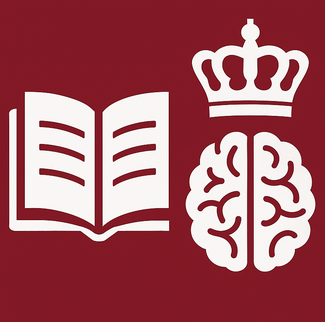

  

    
Independent Research Fund Denmark · 2026–2030

    <h1>Cultural Reasoning for Responsible Language Model Development</h1>
    
How good are LLMs at cultural reasoning? Can we make them better? What does “better” even mean?

    
CuRe brings together natural language processing and literary studies to develop better ways of evaluating and training language models for culturally grounded reasoning.

    

      <a class="button button-primary" href="#hiring">PhD position</a>
      <a class="button button-secondary" href="#publications">Publications</a>
    

  

  

    
  

<nav class="section-nav" aria-label="Page sections">
  <a href="#questions">Research questions</a>
  <a href="#programme">Research programme</a>
  <a href="#publications">Publications</a>
  <a href="#team">Team</a>
  <a href="{{ '/seminar-2026/' | relative_url }}">November seminar</a>
</nav>

<aside class="seminar-callout" aria-labelledby="seminar-heading">
  

    
3 November 2026 · KUA, room 23.3.17

    <h2 id="seminar-heading">Literature, Narrative and Language Models</h2>
    
Join the public morning of our CuRe seminar: talks on literary knowledge, intertextuality, AI fiction, narrative and retrieval. 10:30–12:00; no registration required.

  

  <a class="button button-primary" href="{{ '/seminar-2026/' | relative_url }}">Full programme and abstracts →</a>
</aside>

  

    
We are hiring

    <h2>PhD fellowship in Cultural Reasoning with Language Models</h2>
    
The PhD is centred on NLP: benchmark design, retrieval and RAG, model adaptation, training data, expert feedback, and evaluation under ambiguity. Literature provides the demanding test case, but the research questions concern language-model training and evaluation more broadly.

    

      <strong>Deadline</strong> 8 November 2026
      <strong>Start</strong> 1 February 2027
      <strong>Location</strong> Copenhagen
    

  

  <a class="button button-light" href="https://candidate.hr-manager.net/ApplicationInit.aspx?cid=3010&ProjectId=167227&DepartmentId=19976&MediaId=5124&IsAdPreviewRequest=true&AdvertisementId=122993">Read the call and apply</a>

## Project summary

Culture is not a collection of isolated facts. It is expressed through context, references, recurring patterns, disagreement, and changing interpretations. CuRe studies whether language models can reason with these forms of meaning—and how their evaluation and training should change when no single answer captures the whole task.

We use Danish literature as a rigorous testbed. Literary interpretation requires models to connect claims to textual evidence, use historical and cultural context, consider plausible alternatives, and respond to criticism. These are difficult capabilities that standard factual and multiple-choice benchmarks do not measure well.

  <article class="question-card">
    01
    <h3>Build valid benchmarks</h3>
    
How can we evaluate culturally grounded interpretive reasoning in domains where no unambiguous ground truth exists?

  </article>
  <article class="question-card">
    02
    <h3>Evaluate depth</h3>
    
How can evaluation reflect evidence, ambiguity, disagreement, and context rather than reduce interpretation to a single label?

  </article>
  <article class="question-card">
    03
    <h3>Train better models</h3>
    
How can we adapt and guide LLMs for culturally specific reasoning without reinforcing stereotypes or collapsing plural viewpoints?

  </article>

## Why literature?

Literature is culturally dense and resistant to easy classification. It gives us a controlled but demanding setting for studying capabilities that matter well beyond literary analysis.

  <article>
    <h3>Referencing</h3>
    
Recognising quotations, allusions, echoes, and their changing significance across texts and periods.

  </article>
  <article>
    <h3>Reuse</h3>
    
Tracing motifs, clichés, idioms, and recurring cultural patterns without treating culture as a fixed stereotype.

  </article>
  <article>
    <h3>Interpretation</h3>
    
Supporting readings with evidence, comparing alternatives, and preserving meaningful scholarly disagreement.

  </article>

## Research programme

  <article class="wp-card">
    
WP1 · Empirical foundations

    <h3>Data and benchmark development</h3>
    
Curate Danish literary corpora and co-develop interpretive tasks with literary scholars, using evidence-centred benchmark design and annotations that preserve variation.

  </article>
  <article class="wp-card">
    
WP2 · Methodological reflection

    <h3>Reasoning beyond ground truth</h3>
    
Evaluate retrieval, RAG, and long-context models; study interpretive hallucinations; and develop protocols that separate identifiable errors, evidential support, and plausibility.

  </article>
  <article class="wp-card">
    
WP3 · Model development

    <h3>Adaptation and training</h3>
    
Test how pretraining mixtures, contextual resources, fine-tuning, and feedback from literary scholars affect cultural reasoning while preserving ambiguity and plural perspectives.

  </article>

## Publications

  <article class="publication-card">
    
Perspective preprint2026

    <h3><a href="https://arxiv.org/abs/2609.30897">From annotation to reasoning: Culture in language models</a></h3>
    
Daniel Hershcovich, Alexander Conroy, and Jens Bjerring-Hansen

    
We argue that cultural evaluation must address interpretive depth: whether a model can support a reading with evidence, consider alternatives, and revise it after criticism. The paper connects benchmark design, expert evaluation that preserves disagreement, and experiments on data, context, and feedback.

    <a class="text-link" href="https://arxiv.org/abs/2609.30897">Read the preprint →</a>
  </article>

  <article class="publication-card">
    
Accepted · CHR 20272027

    <h3><a href="https://arxiv.org/abs/2609.35765">Retrieving Biblical Intertextual References in Karen Blixen’s <i>Seven Gothic Tales</i></a></h3>
    
András Kovacs, Alexander Conroy, Daniel Hershcovich, and Jens Bjerring-Hansen

    
Accepted at <a href="https://2027.computational-humanities-research.org/">Computational Humanities Research (CHR) 2027</a> in Manchester for a long oral presentation (22 minutes including Q&amp;A).

    
We compare sparse and dense retrieval methods for finding transformed cultural references across historical language and translation. Fine-tuning improves retrieval substantially, while expert reassessment shows why benchmark annotations cannot always be treated as exhaustive ground truth.

    <a class="text-link" href="https://arxiv.org/abs/2609.35765">Read the preprint →</a>
  </article>

## Expected outcomes

  
<strong>Benchmarks</strong>Evidence-centred tasks for cultural and literary reasoning

  
<strong>Data</strong>Open corpora and expert annotations grounded in Danish literature

  
<strong>Methods</strong>Evaluation protocols that preserve ambiguity and disagreement

  
<strong>Models</strong>Training and adaptation strategies for culturally robust reasoning

## Team

  <article class="person-card">
    
Principal Investigator · NLP

    <h3><a href="https://danielhers.github.io/">Daniel Hershcovich</a></h3>
    
Department of Computer Science, University of Copenhagen

  </article>
  <article class="person-card">
    
Co-Principal Investigator · Literary Studies

    <h3><a href="https://nors.ku.dk/ansatte/?pure=da/persons/195540">Jens Bjerring-Hansen</a></h3>
    
Department of Nordic Studies and Linguistics, University of Copenhagen

  </article>
  <article class="person-card">
    
Advisor · NLP

    <h3><a href="https://elliottd.github.io/">Desmond Elliott</a></h3>
    
Department of Computer Science, University of Copenhagen

  </article>
  <article class="person-card">
    
Postdoctoral Researcher

    <h3>Alexander Conroy</h3>
    
Computational literary studies and cultural analytics

  </article>
  <article class="person-card person-card-open">
    
Open position · Start February 2027

    <h3><a href="https://candidate.hr-manager.net/ApplicationInit.aspx?cid=3010&ProjectId=167227&DepartmentId=19976&MediaId=5124&IsAdPreviewRequest=true&AdvertisementId=122993">PhD Fellow</a></h3>
    
Cultural reasoning, language-model evaluation, and model adaptation

  </article>

  

    <h3>International collaborators</h3>
    <ul>
      <li>David Bamman, UC Berkeley</li>
      <li>Timothy Tangherlini, UC Berkeley</li>
      <li>Maria Antoniak, University of Colorado</li>
      <li>Jackie Cheung, McGill University</li>
    </ul>
  

  

    <h3>Advisory board</h3>
    <ul>
      <li>Serge Belongie</li>
      <li>Anders Søgaard</li>
      <li>Carsten Levisen</li>
      <li>Bolette Sandford Pedersen</li>
    </ul>
  

  

    
Contact

    <h2>Interested in the project?</h2>
    
For research inquiries and collaboration, contact Daniel Hershcovich at <a href="mailto:dh@di.ku.dk">dh@di.ku.dk</a>.

  

  
CuRe is funded by the <a href="https://dff.dk/om-fonden/nyheder-og-presse/alle-nyheder/nyheder/2025/oktober/53-mio-kr-til-forskning-i-kunstig-intelligens/">Independent Research Fund Denmark</a> through the thematic programme on artificial intelligence.

